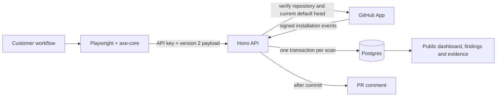

# Intygy — Architecture

Intygy scans inside customer GitHub Actions and stores results in an operator-hosted
Hono/Postgres API. The installed GitHub App verifies repository metadata and posts
PR comments. Dashboard, scan-report, and evidence URLs are public UUID URLs.



## Components and trust boundaries

- `packages/action`: resolve the target, confirm readiness/authentication, scan all
  configured route/viewport combinations, submit results, and fail on new PR findings.
- `packages/api/src/app.ts`: testable Hono routes; `index.ts` starts the Node server.
- `lib/ingest.ts`: authenticated repository isolation, locking, retry replay, and baseline lifecycle.
- `lib/webhook.ts`: installation provisioning, suspension/removal, and key rotation on reauthorization.
- `lib/evidence.ts` / `lib/report.ts`: stored coverage, findings, and dated lifecycle events.
- `packages/shared/types.ts`: versioned Action/API contracts; this directory remains types-only.

The project API key authorizes submitted results for exactly one repository. Each
submission also carries a GitHub Actions OIDC token issued for the API's public URL;
`lib/oidc.ts` verifies it and rejects scans whose repository, branch, commit, or pull
request number differ from the attested run. A pull-request run holding the key therefore
cannot submit a default-branch scan. The pull-request head SHA stays self-reported because
GitHub signs the merge commit. Results remain customer-produced evidence: the token proves
which run submitted them, not that the scanned target or its findings were trustworthy. The operator's GitHub App needs Metadata read, Contents read (branch
head verification), and Pull requests write plus Issues write (PR comments). The customer `GITHUB_TOKEN` needs
Deployments read when resolving previews. Webhooks require the configured HMAC secret.

## Scan lifecycle

1. Validate the version 2 payload, including its submission ID, routes, viewports,
   timestamps and finding coverage. Legacy clients receive an explicit upgrade error.
2. Begin a transaction and lock the authenticated project row. Recheck repository
   ownership and active installation/repository authorization under this lock.
3. If the submission ID already exists, return its stored response unchanged. Reusing
   an ID with different content returns 409. Removed installations cannot replay scans.
4. Read the actual default branch and its head SHA through the GitHub App while holding
   the project lock. This prevents queued requests from using an earlier head snapshot.
   GitHub verification failures roll back ingestion. Verification requests have timeouts.
5. Split axe rule groups into one finding per element. The `v2:` fingerprint includes
   rule, route, viewport, and the exact selector. Sibling positions are significant;
   selector changes may produce new findings. Node order within an axe result does not.
6. The first successful scan establishes the baseline without blocking, including a PR
   scan. A stale default-branch scan cannot initialize a project. After initialization,
   only a non-PR scan whose branch and SHA match the verified default-branch head may
   update baseline state. Other branch scans and stale default scans remain in history
   with an explicit notice and do not accept or resolve debt.
7. PRs compare against open baseline fingerprints. New elements block; known debt does not.
8. Default-branch updates absorb observed findings. Missing findings resolve only when
   their route, viewport and ruleset are all covered by this successful scan. Removing a
   route/viewport or changing rulesets does not manufacture fixes. Unmapped legacy rows
   remain unchanged and visibly outside verified coverage.
9. Persist the scan, findings, baseline updates, lifecycle events, and exact response in
   one transaction. A database error rolls everything back. Per-project row locks also
   serialize concurrent first scans. Scan receipt timestamps are taken after acquiring
   the lock, rather than using a waiting transaction's start time.
10. After commit, attempt a PR comment once. Failure cannot roll back the scan; all
    findings remain available in the linked scan report. Replays do not duplicate comments.
    Comment delivery is best-effort; there is no background retry queue in this MVP.

The Action generates a UUID once per invocation, preserving it and the exact payload
across up to three transport attempts. Separate steps, matrix jobs, and workflow reruns
are distinct scans. Client requests have a 30-second timeout. A fresh invocation is not
an idempotent retry of an older invocation.

## Coverage and scanner behavior

`readySelector` is required and must identify loaded application content on every route.
HTTP errors, unexpected redirects (except a trailing slash), missing readiness, and
unconfirmed authentication fail the scan before ingestion. Configure canonical routes;
query strings and URL fragments are part of the destination check. Route normalization
cannot leave the target origin. Login additionally requires `auth.success_selector`,
which must be visible after login and on each scanned page.

All failing axe nodes are retained. Single selectors remain plain CSS; compound
iframe/shadow targets use structured JSON to retain their boundaries. Only violations
are persisted; axe's absence of a violation is not proof of criterion conformance.
Interactive states beyond the configured initial page state still require manual testing.

A fixed staging URL does not prove that a PR's code was deployed there. Prefer a preview
resolved for the commit or a local build. The GitHub check authenticates repository state,
not the provenance of the rendered bytes. For local PR builds, check out the PR head SHA
so the recorded commit matches the code being served.

## Installation lifecycle

Provisioning reads the actual default branch; every new ingestion refreshes it to handle
renames. Repository removal disables that project. Installation deletion disables the
installation and its projects. Suspension pauses ingestion; unsuspension restores the
installation without restoring repositories previously removed. Re-adding a removed
repository or changing installations rotates its API key. The operator must deliver the
new key manually. Duplicate provisioning preserves active keys.

## API routes

| Route | Authentication | Purpose |
| --- | --- | --- |
| `POST /api/ingest` | Project Bearer key | Validate, store, compare and return gate result |
| `POST /api/github/webhook` | HMAC signature | Installation and repository lifecycle |
| `GET /p/:id` | None | Recent scans and baseline count |
| `GET /p/:id/scans/:scanId` | None | Every finding for that project's scan |
| `GET /p/:id/evidence` | None | Recorded coverage, partial criteria register and lifecycle events |
| `GET /healthz` | None | Process liveness, not database readiness |

## Evidence and migration

Evidence uses the latest accepted default-branch scan, shows its commit/date/routes/
viewports/ruleset, and distinguishes unknown coverage, observed findings and no recorded
automated findings. PR scans are never counted as merges. Criteria still require manual
review; attestations are dated records and do not prove the current commit is conformant.

`baseline_events` preserves observed, resolved and reopened events linked to scans.
Reopening never deletes prior resolution history. Legacy first-seen and last-resolution
dates are imported with a legacy label; earlier overwritten cycles cannot be recovered.

For existing databases, stop the API and apply `db/migrations/001-flow-integrity.sql`
before deploying the updated API and Action together. See `INSTALL.md` for rollout and
backup instructions. Fresh installations apply `db/schema.sql`.

## Verification

```sh
pnpm install --frozen-lockfile
pnpm --filter @intygy/action exec playwright install --with-deps chromium
pnpm test
pnpm typecheck
pnpm build:action
```

Tests exercise real SQL through development-only PGlite by default. Set
`INTYGY_TEST_DATABASE_URL` to a **disposable Postgres database** to run the same migration,
rollback, concurrency, authorization and reporting tests over independent connections.
The harness creates and drops isolated test schemas; never point it at production. CI
provides Postgres 16 and Chromium. PGlite serializes its transactions and therefore does
not independently prove multi-connection lock behavior.

For a locally installed Chrome, `INTYGY_TEST_BROWSER_CHANNEL=chrome pnpm test` runs the
browser tests without downloading Chromium. Live GitHub App permissions, real preview
deployments, and hosted ingestion still require separate end-to-end acceptance:

1. Install the App, retrieve the project key, and run an initial scan (green).
2. Add an inaccessible element in a PR (red, complete scan report, best-effort comment).
3. Fix it and merge; verify the default-branch scan records resolution history.
4. Remove a scanned route and confirm its old findings remain open/outside coverage.
5. Remove the repository from the App and confirm its key no longer ingests results.
