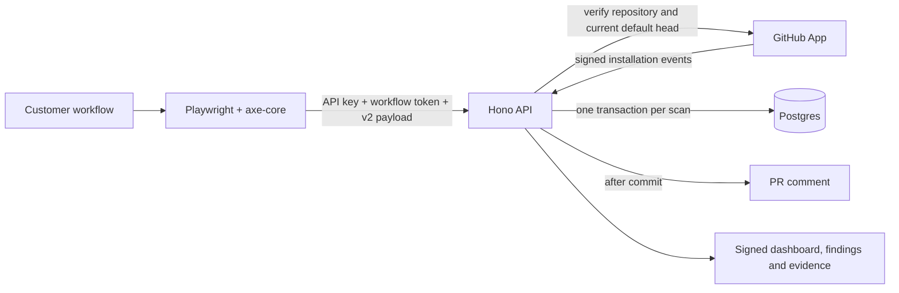

# Intygy architecture

Intygy scans your web app inside GitHub Actions. Its hosted API tracks existing accessibility findings and tells the workflow when a pull request introduces a new one.



| Component | What it does |
| --- | --- |
| Customer workflow | Runs the Intygy Action in the customer’s repository and reports the check result on GitHub. |
| Playwright + axe-core | Playwright opens each configured page at each viewport, and axe-core checks the rendered content for accessibility violations. |
| Hono API | Verifies the submission, compares findings with the repository’s baseline, and returns the result to the Action. |
| GitHub App | Supplies repository and branch metadata, sends installation events, and gives Intygy permission to comment on PRs. |
| Postgres | Stores projects, scans, individual findings, baselines, and their history. |
| PR comment | Shows new findings and links to the dashboard after the API saves the scan. |
| Signed dashboard, findings and evidence | Let a link holder review scans, inspect affected elements, and export recorded evidence. |

## Who can submit and read scans?

- **Submissions.** A project API key identifies one repository. The API also verifies the GitHub Actions OIDC token’s signature, issuer, audience (the API URL), and expiry. Pushes must match the signed repository, branch, and commit. PRs must match the signed repository and PR number. The Action supplies the PR head branch and SHA. The workflow identity is verified, while the scanned content and findings come from the customer’s runner.
- **GitHub access.** The operator’s App needs Metadata and Contents read access to verify repository state, plus Pull requests and Issues write access for comments. The customer workflow uses Deployments read access to find previews. Installation webhooks require an HMAC signature.
- **Report access.** Anyone holding an unexpired signed link can read all report pages for that project without a login. The API signs the project ID and expiry with `LINK_SIGNING_SECRET`. Ingest responses and PR comments carry fresh links valid for 30 days. Rotating the secret revokes all existing links.

## How a scan changes the baseline

The baseline is the set of open findings already recorded for a repository. The API tracks each failing element by its rule, route, viewport, and exact selector (`v2:` fingerprint). Changing a selector or sibling position can produce a new finding. Reordering axe’s results preserves the fingerprints.

| Scan | Result |
| --- | --- |
| First successful scan | Records existing findings and passes, including on a PR. A stale default-branch scan cannot establish the baseline. |
| Subsequent PR | Fails the check if it finds any fingerprint outside the open baseline. |
| Current default-branch head | Adds observed findings and resolves missing ones only within the route, viewport, and ruleset scanned. Unmapped legacy findings stay open. |
| Other branch or stale default-branch head after setup | Records the scan in history and leaves the baseline intact. |

### Storage and retries

1. The API validates the v2 payload, submission ID, timestamps, and coverage. Older clients receive an upgrade error.
2. It locks the project row, records receipt time, and rechecks repository ownership and installation access. The lock serializes concurrent scans, including the first baseline. It checks the current default branch and head through GitHub under the same lock for each new submission.
3. It saves the scan, findings, baseline changes, lifecycle events, and response in one transaction. A database error or failed GitHub verification rolls back the transaction.
4. After commit, the API attempts the PR comment once. The report remains available if posting fails.

The Action uses one submission ID and payload across up to three transport attempts, with a 30-second timeout per request. An authorized replay returns the stored gate result and a fresh dashboard link without duplicating the comment. Reusing the ID with different content returns HTTP 409. A workflow rerun, separate step, or matrix job gets a new ID.

The scanner lives in `packages/action`. The API routes start in `packages/api/src/app.ts`, with baseline handling in `lib/ingest.ts` and token verification in `lib/oidc.ts` under the same directory. The Action and API share payload types in `packages/shared/types.ts`.

## Coverage and scanner behavior

`readySelector` is required and must identify loaded application content on every route.
HTTP errors, unexpected redirects (except a trailing slash), missing readiness, and
unconfirmed authentication fail the scan before ingestion. Configure canonical routes;
query strings and URL fragments are part of the destination check. Route normalization
cannot leave the target origin. Login additionally requires `auth.success_selector`,
which must be visible after login and on each scanned page.

All failing axe nodes are retained. Single selectors remain plain CSS; compound
iframe/shadow targets use structured JSON to retain their boundaries. Only violations
are persisted; axe's absence of a violation is not proof of criterion conformance.
Interactive states beyond the configured initial page state still require manual testing.

A fixed staging URL does not prove that a PR's code was deployed there. Prefer a preview
resolved for the commit or a local build. The GitHub check authenticates repository state,
not the provenance of the rendered bytes. For local PR builds, check out the PR head SHA
so the recorded commit matches the code being served.

## Installation lifecycle

Provisioning reads the actual default branch; every new ingestion refreshes it to handle
renames. Repository removal disables that project. Installation deletion disables the
installation and its projects. Suspension pauses ingestion; unsuspension restores the
installation without restoring repositories previously removed. Re-adding a removed
repository or changing installations rotates its API key. The operator must deliver the
new key manually. Duplicate provisioning preserves active keys.

## API routes

| Route | Authentication | Purpose |
| --- | --- | --- |
| `POST /api/ingest` | Project bearer key + GitHub workflow token | Validate, store, compare and return gate result |
| `POST /api/github/webhook` | HMAC signature | Installation and repository lifecycle |
| `GET /p/:id` | Signed project link | Recent scans and baseline count |
| `GET /p/:id/scans/:scanId` | Signed project link | Every finding for that project's scan |
| `GET /p/:id/evidence` | Signed project link | Recorded coverage, partial criteria register and lifecycle events |
| `GET /healthz` | None | Process liveness, not database readiness |

## Evidence and migration

Evidence uses the latest accepted default-branch scan, shows its commit/date/routes/
viewports/ruleset, and distinguishes unknown coverage, observed findings and no recorded
automated findings. PR scans are never counted as merges. Criteria still require manual
review; attestations are dated records and do not prove the current commit is conformant.

`baseline_events` preserves observed, resolved and reopened events linked to scans.
Reopening never deletes prior resolution history. Legacy first-seen and last-resolution
dates are imported with a legacy label; earlier overwritten cycles cannot be recovered.

For existing databases, stop the API and apply `db/migrations/001-flow-integrity.sql`
before deploying the updated API and Action together. See `INSTALL.md` for rollout and
backup instructions. Fresh installations apply `db/schema.sql`.

## Verification

```sh
pnpm install --frozen-lockfile
pnpm --filter @intygy/action exec playwright install --with-deps chromium
pnpm test
pnpm typecheck
pnpm build:action
```

Tests exercise real SQL through development-only PGlite by default. Set
`INTYGY_TEST_DATABASE_URL` to a **disposable Postgres database** to run the same migration,
rollback, concurrency, authorization and reporting tests over independent connections.
The harness creates and drops isolated test schemas; never point it at production. CI
provides Postgres 16 and Chromium. PGlite serializes its transactions and therefore does
not independently prove multi-connection lock behavior.

For a locally installed Chrome, `INTYGY_TEST_BROWSER_CHANNEL=chrome pnpm test` runs the
browser tests without downloading Chromium. Live GitHub App permissions, real preview
deployments, and hosted ingestion still require separate end-to-end acceptance:

1. Install the App, retrieve the project key, and run an initial scan (green).
2. Add an inaccessible element in a PR (red, complete scan report, best-effort comment).
3. Fix the PR finding and confirm the check clears. Separately, fix an open baseline finding and verify the matching default-branch scan records its resolution.
4. Remove a scanned route and confirm its old findings remain open/outside coverage.
5. Remove the repository from the App and confirm its key no longer ingests results.
